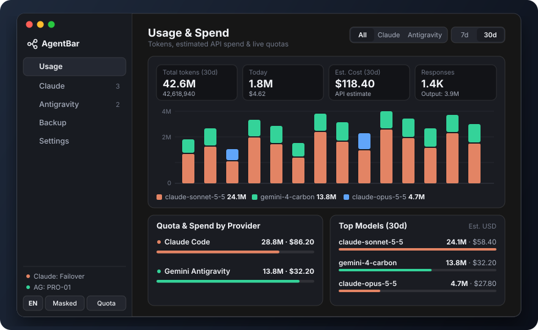
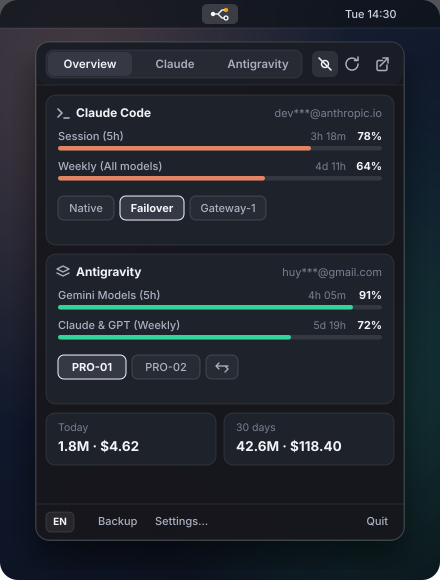

<div align="center">
  
  <h1>AgentBar</h1>
  <p>
    <b>Native macOS menu bar app to switch Claude Code gateways &amp; Gemini Antigravity accounts in one click — with live 5h/weekly quotas, token spend analytics &amp; auto-failover.</b>
  </p>
  <p>
    
    
    
    
  </p>
  <p>
    <a href="#english">English</a> · <a href="#tiếng-việt">Tiếng Việt</a> · <a href="#quick-start--cài-đặt-nhanh">Quick Start</a> · <a href="#github-repo-metadata">GitHub About &amp; Topics</a>
  </p>
</div>

---

<p align="center">
  
  
</p>

---

## English

**AgentBar** is an ultra-lightweight (~7 MB `.app`), privacy-first macOS menu bar utility built with **Rust & Tauri v2** (English default + 1-click `EN`/`VI` switch), inspired by [CodexBar](https://github.com/steipete/CodexBar) and [antigravity-account-switcher](https://github.com/muriel-gasparini/antigravity-account-switcher):

- **1-Click Menu Bar HUD:** Native macOS vibrancy glass popover (left-click) & native menu (right-click) to switch accounts before hitting rate limits.
- **Claude Code Gateways & Auto-Failover:** Toggle between Native login (`~/.claude`), custom API gateways with model prefixes (`cc/`, `anthropic/`, Bedrock), or zero-downtime local failover proxy (`127.0.0.1:18431`).
- **Gemini Antigravity Multi-Account:** Capture, switch, and cycle pre-declared accounts (`state.vscdb`, Keychain `gemini/antigravity`, `~/.gemini`) in complete isolation from Claude configs.
- **Live 5h/Weekly Quotas & Token Spend:** Track remaining quota bars, burn-rate **Pace** (reserve vs. deficit), countdown timers, and 7d/30d token + USD cost charts across both Claude and Antigravity.
- **Privacy & Safe Backup:** Masks emails/URLs with `***` by default (`P` key). Export/import sanitized or `0600` secret bundles (`Merge` / `Replace`) with automatic pre-import snapshots.

---

## Tiếng Việt

**AgentBar** là ứng dụng thanh menu macOS siêu nhẹ (~7 MB `.app`, mặc định Tiếng Anh kèm nút chuyển nhanh `EN`/`VI`), giúp bạn điều phối mượt mà các tài khoản AI coding mà không sợ đứt quãng khi hết hạn mức:

- **Menu Bar HUD chuẩn macOS:** Chuột trái mở Popover kính mờ (vibrancy), chuột phải mở menu chuyển nhanh 1-click.
- **Claude Code & Failover tự động:** Chuyển đổi tức thì giữa tài khoản gốc (`Native`), các Gateway kèm tiền tố model (`cc/`, `anthropic/`…), hoặc chuỗi dự phòng tự động qua proxy cục bộ.
- **Đa tài khoản Gemini Antigravity:** Lưu phiên và luân chuyển nhiều tài khoản khai báo sẵn (tách biệt hoàn toàn với `~/.claude`).
- **Hạn mức Live & Thống kê Chi tiêu:** Theo dõi thanh quota `5h` / `Weekly`, nhịp tiêu thụ (**Pace**), đếm ngược reset và biểu đồ token + chi phí USD 7/30 ngày cho cả Claude lẫn Antigravity.
- **Bảo mật & Sao lưu Di động:** Mặc định che email/URL bằng `***` (phím `P`). Hỗ trợ xuất/nhập JSON (`Merge` / `Replace`) kèm snapshot an toàn tự động trước mỗi lần import.

---

## Quick Start / Cài đặt nhanh

```bash
# 1. Create local config files from clean templates (gitignored for safety)
cp profiles.example.json profiles.json
cp antigravity.example.json antigravity.json

# 2. Run in development mode
cd tauri-app && npm install && npm run tauri dev

# 3. Build optimized macOS Release (AgentBar.app & AgentBar_0.1.0_aarch64.dmg)
cd tauri-app && npm run tauri build
```

### CLI Companion

```bash
node claude-switch.mjs list
node claude-switch.mjs use <key|native>
node claude-switch.mjs backup ./agentbar-backup.json [--with-secrets]
node claude-switch.mjs restore-backup ./agentbar-backup.json [--replace]
```

### Shortcuts / Phím tắt

| Shortcut | Action (EN / VI) |
| :--- | :--- |
| `P` | Toggle `***` privacy masking / Bật tắt ẩn thông tin nhạy cảm |
| `⌘R` | Refresh live quotas & usage / Làm mới hạn mức & thống kê |
| `⌘1` – `⌘5` | Switch Dashboard tabs (`1` – `3` in Popover) |
| `⌘,` | Open Settings / Mở Cài đặt |
| `Esc` | Close Popover or Modal / Đóng Popover hoặc hộp thoại |

---

## GitHub Repo Metadata

Copy these directly into your GitHub repository's **About** settings for discoverability:

- **Repository Name:** `AgentBar`
- **Description:**
  > Native macOS menu bar app to switch Claude Code gateways & Gemini Antigravity accounts in one click — with live 5h/weekly quotas, token spend analytics & auto-failover (Rust + Tauri v2).
- **Topics:**
  `agentbar` `claude-code` `antigravity` `gemini` `anthropic` `macos` `menubar` `tauri` `rust` `ai-agents` `token-usage` `rate-limit` `llm-gateway`
